# Previews

Full-size previews, one per language. Every image is rendered from the theme file by `tools/render_preview.py` (a Pygments approximation of the grammars, not a VS Code screenshot). Click a language to expand it.

## Dark

Python

  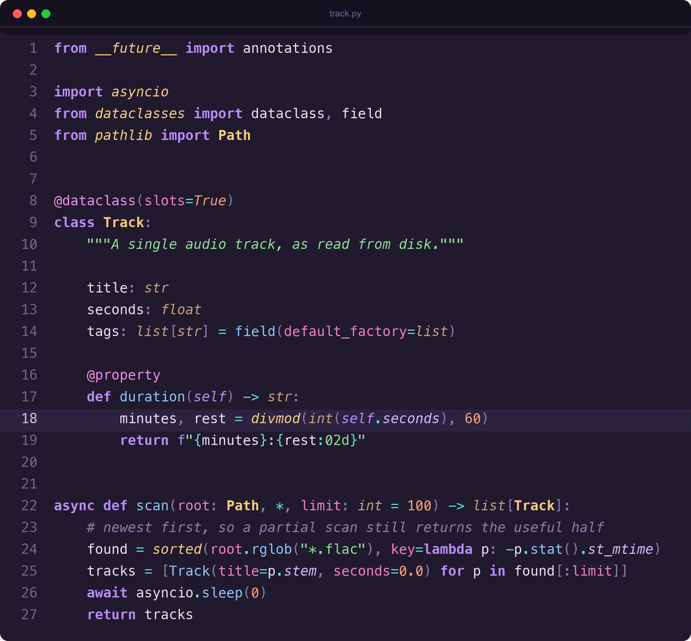

TypeScript

  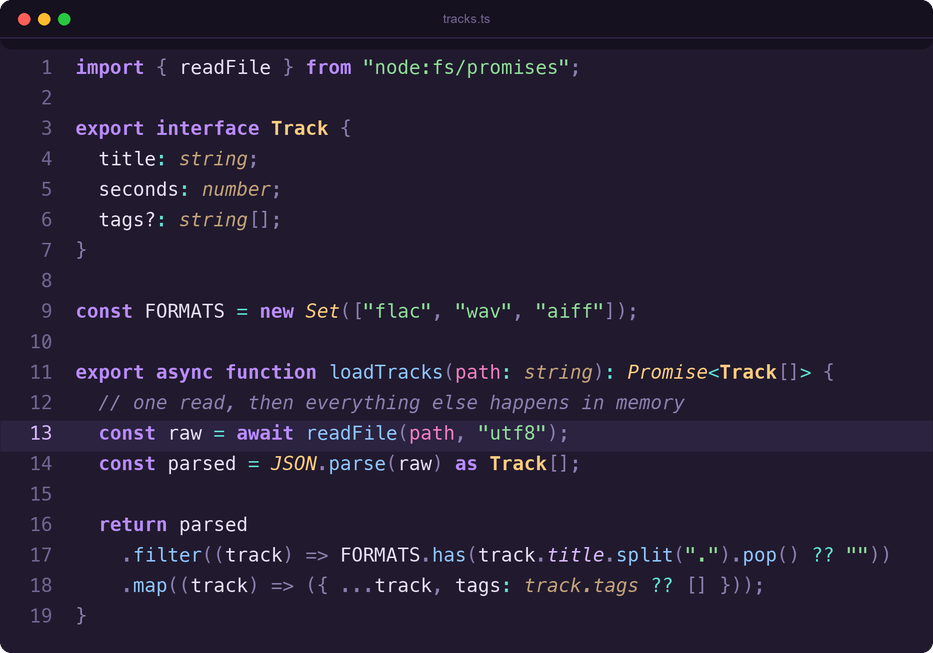

TSX

  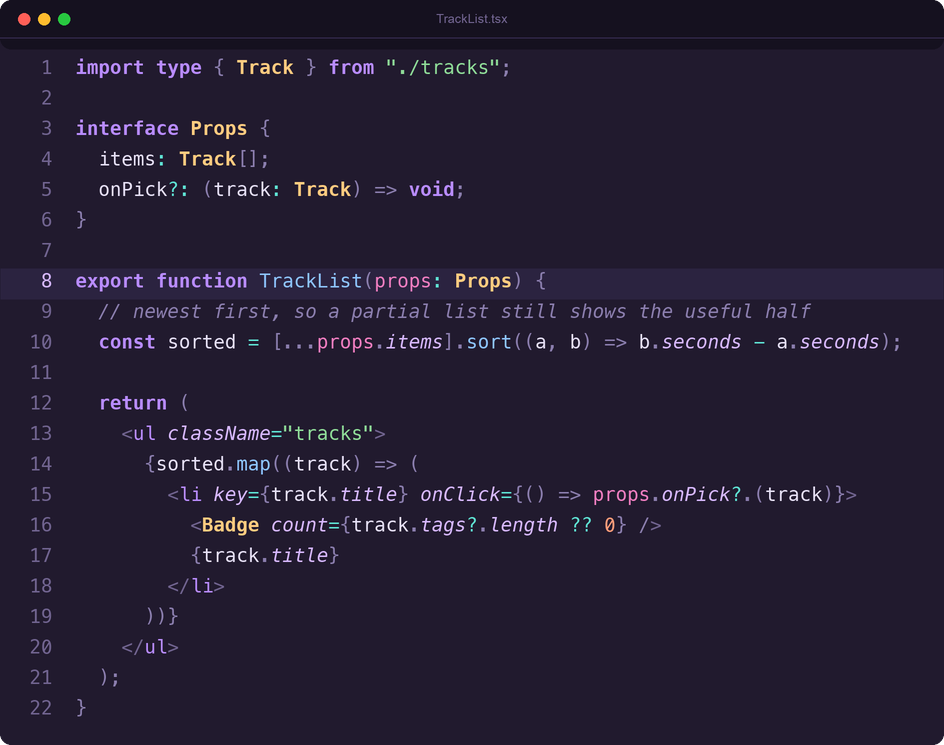

JavaScript

  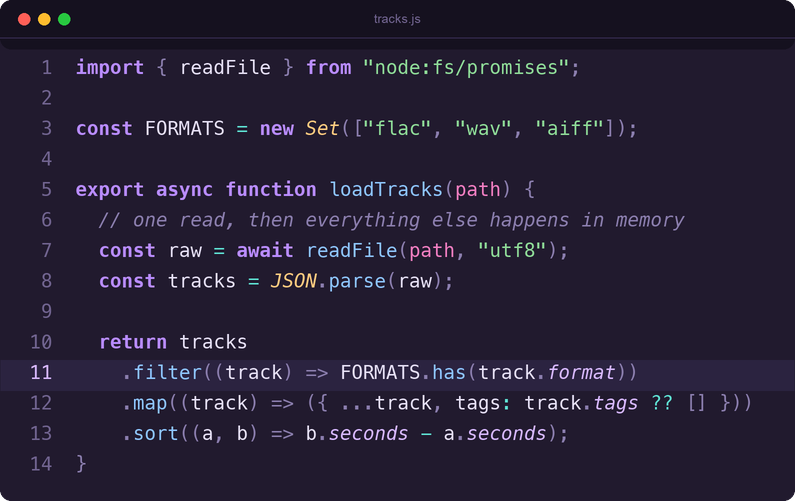

Go

  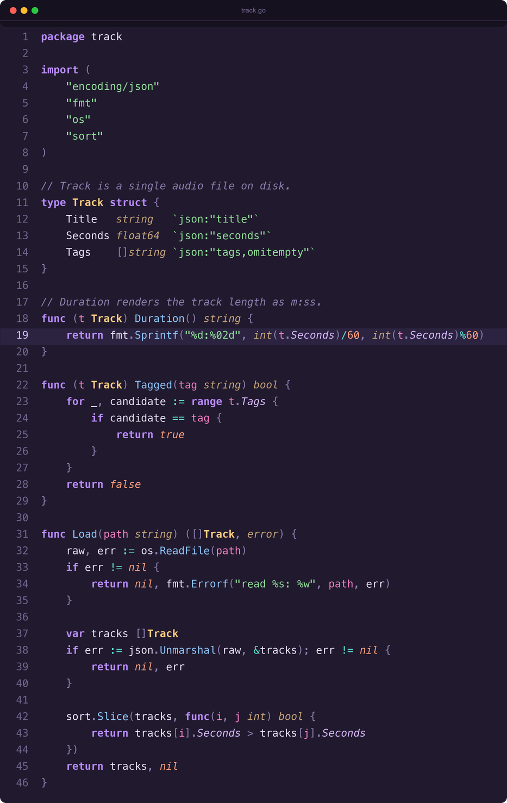

Rust

  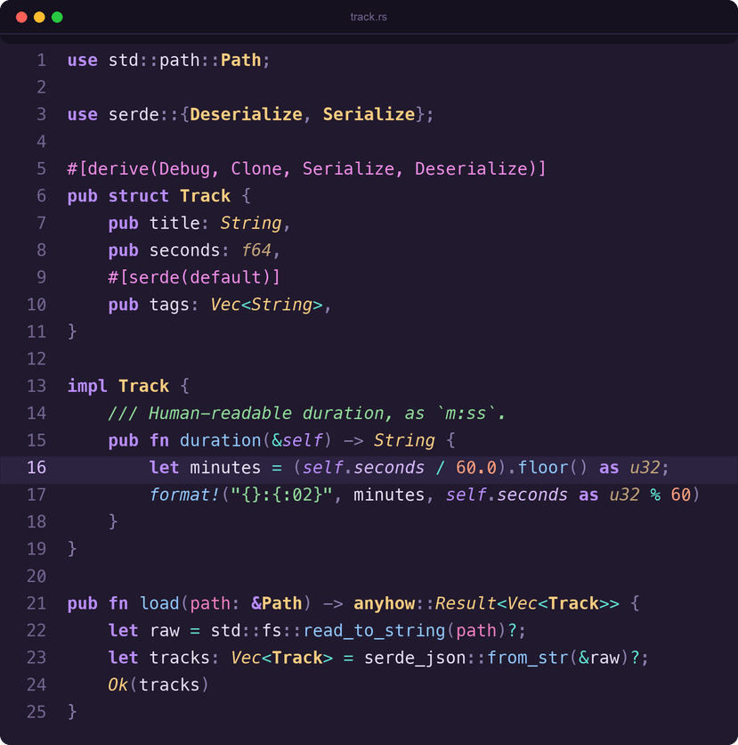

C++

  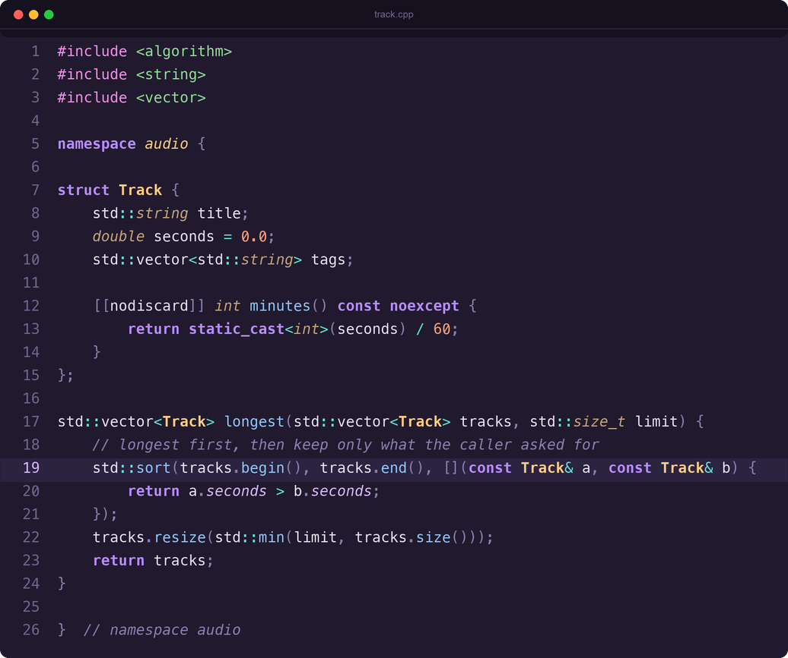

Java

  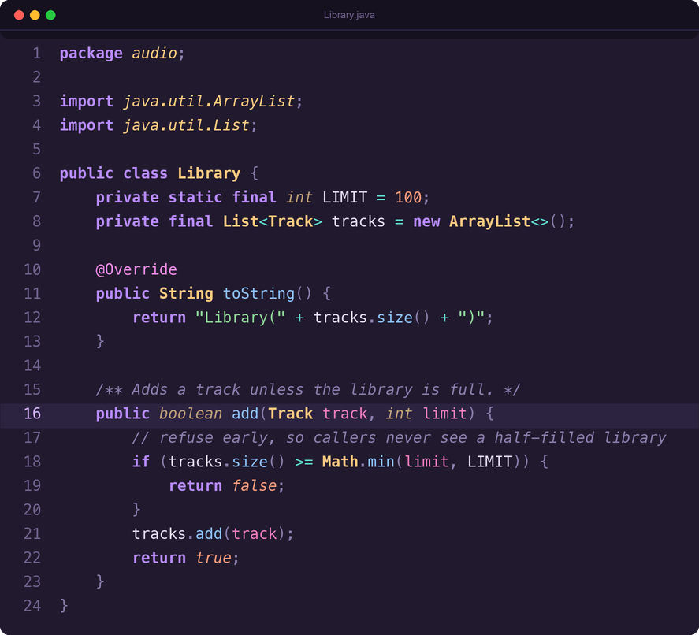

C#

  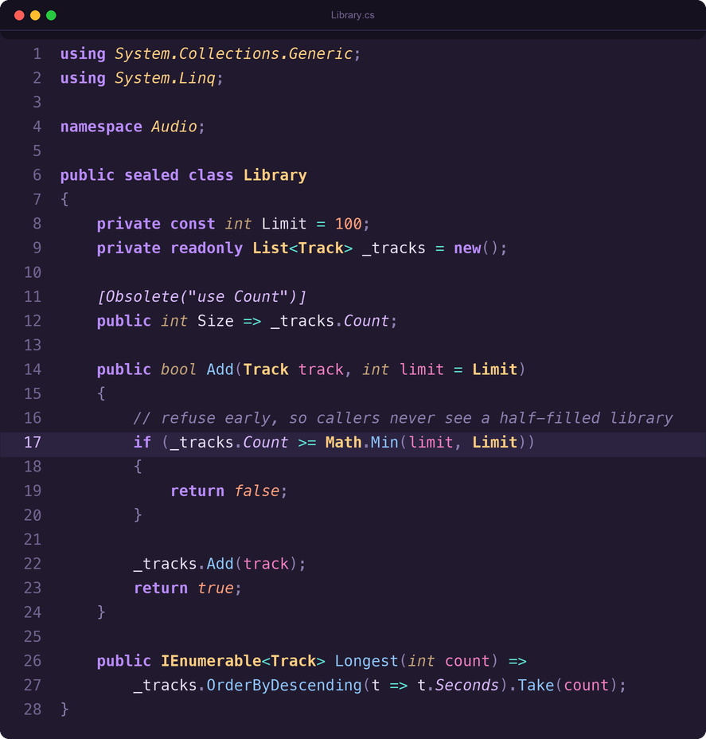

PHP

  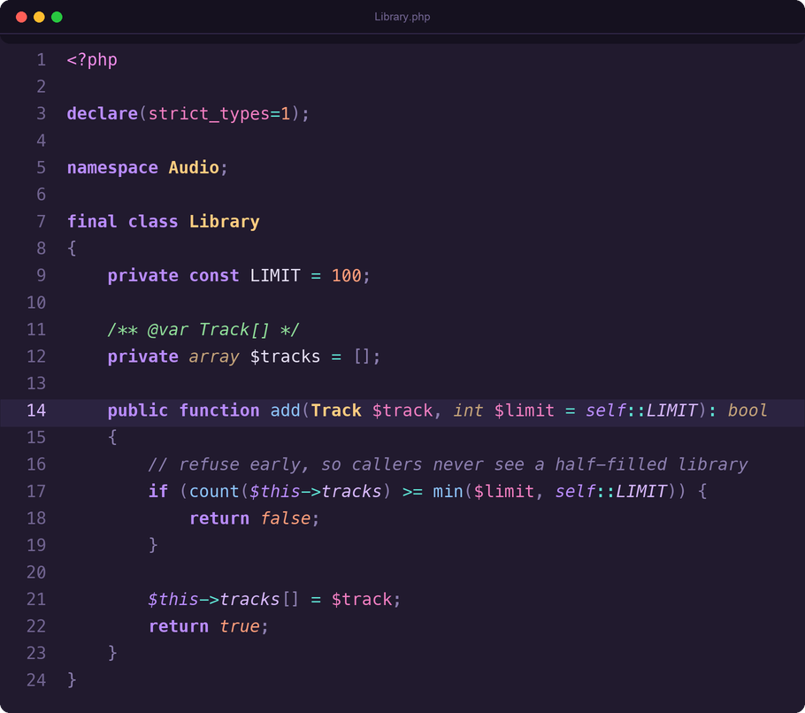

HTML

  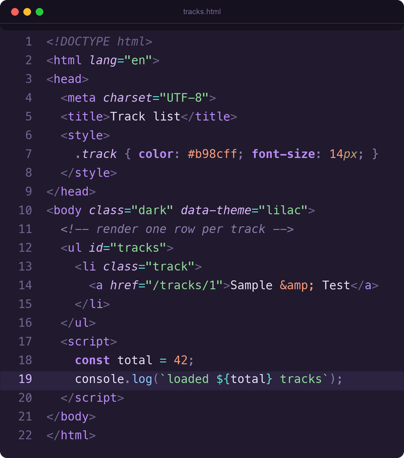

## Light

The same samples in **Lilac Nights Light**.

Python (light)

  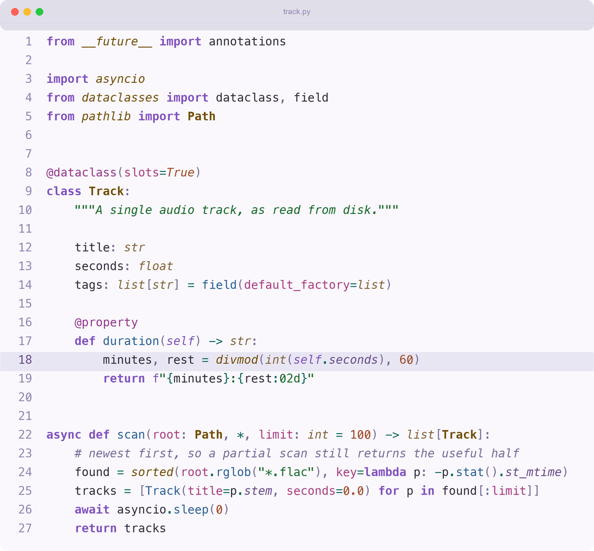

TypeScript (light)

  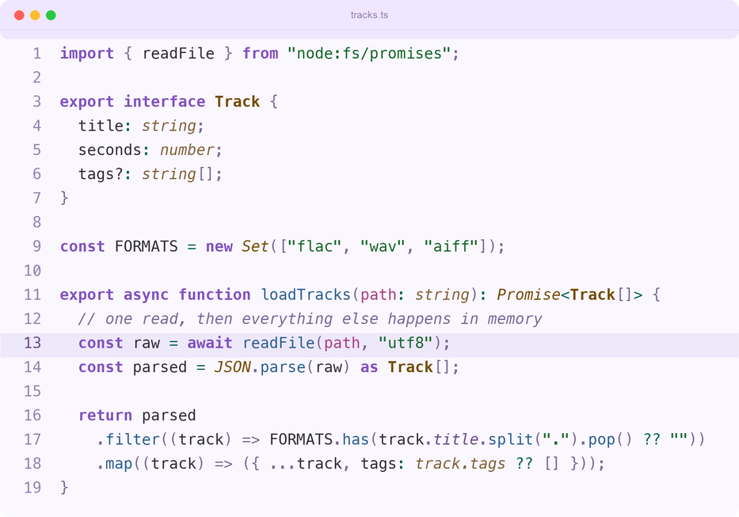

Java (light)

  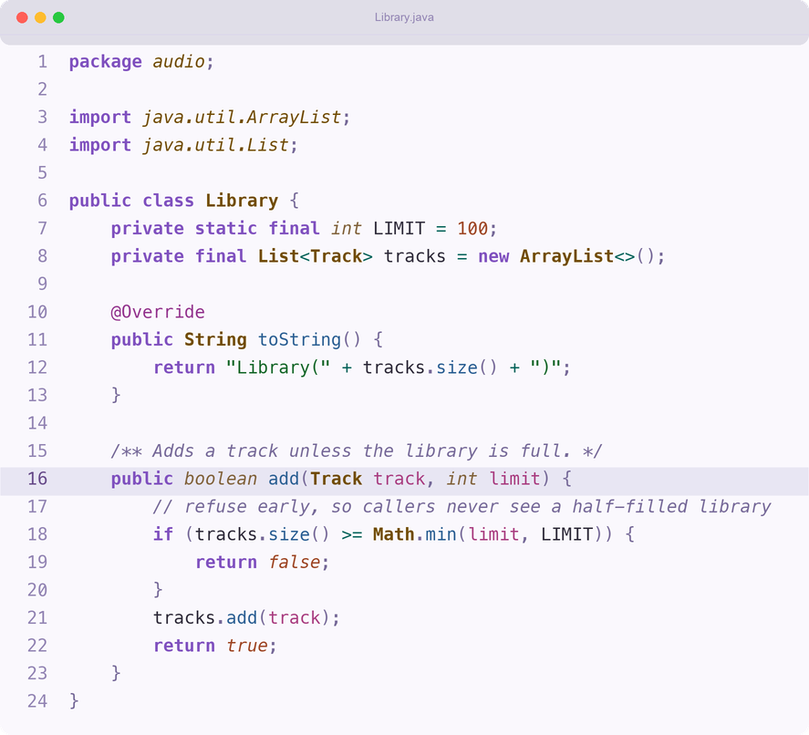

  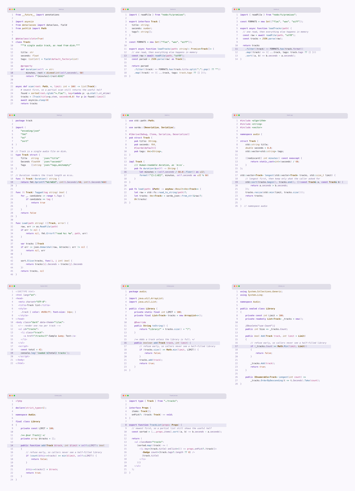

